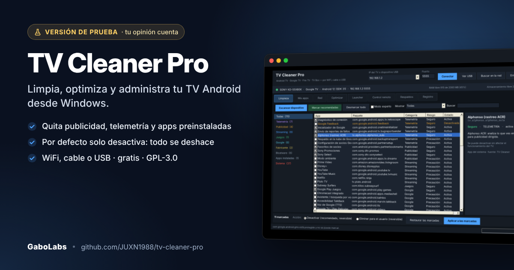
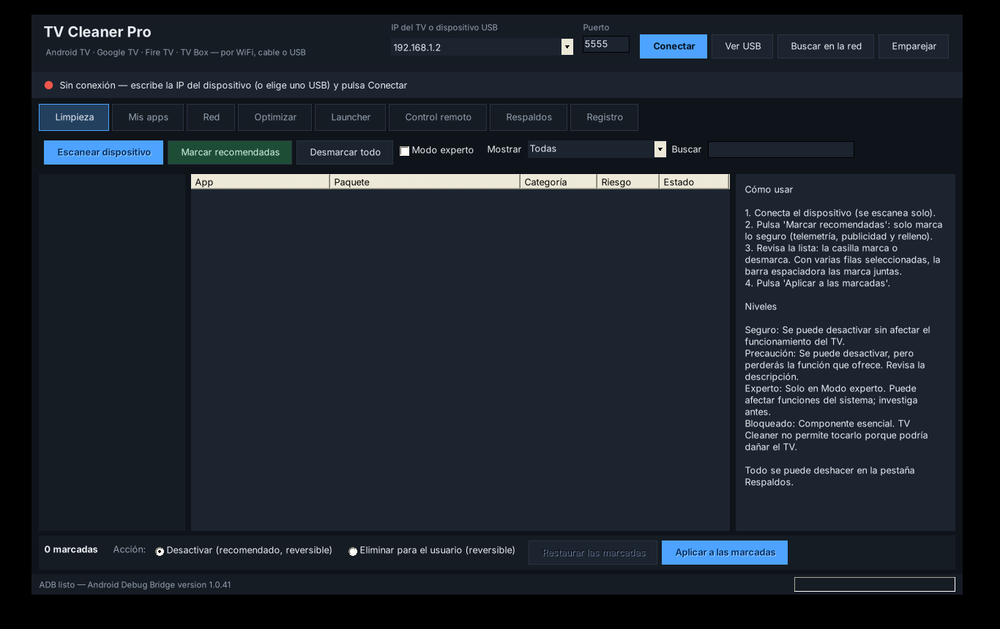
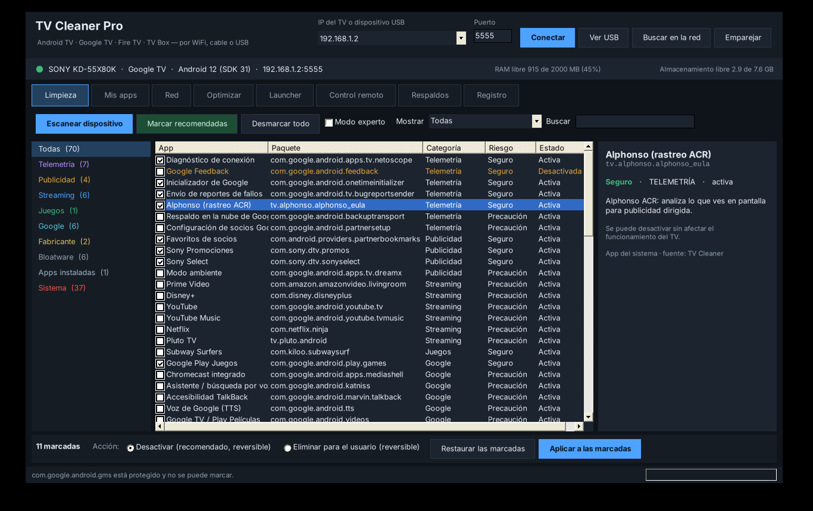
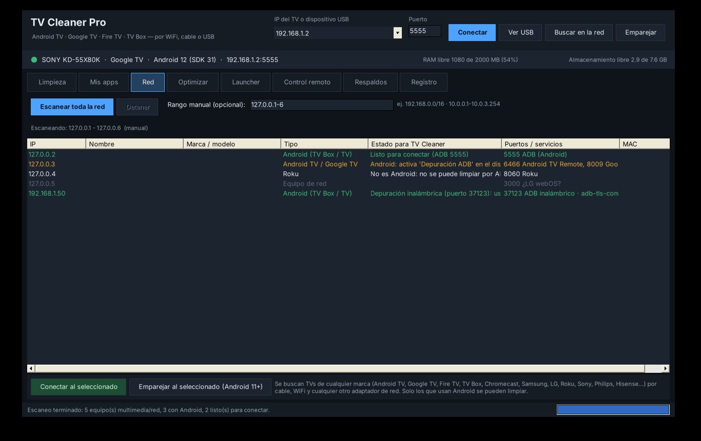
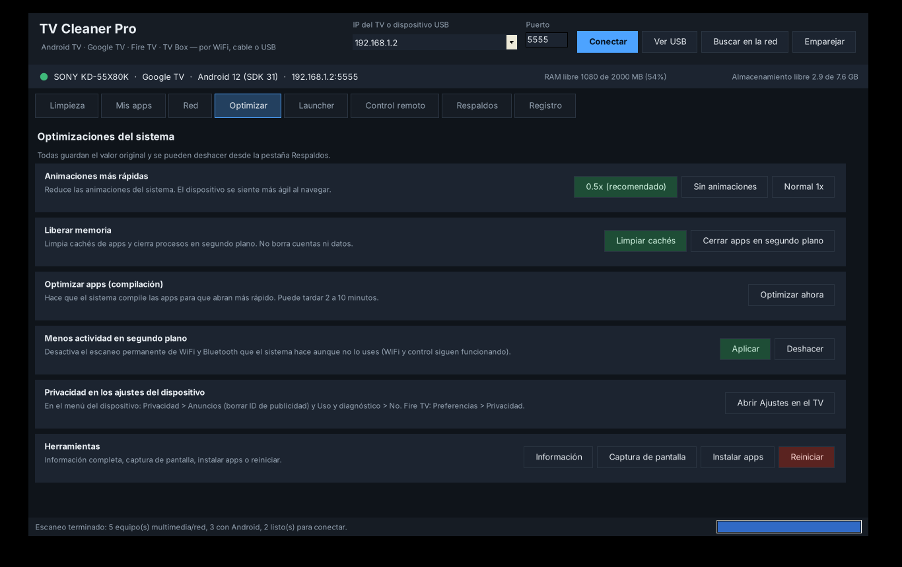

# TV Cleaner Pro



**Limpia, optimiza y administra tu TV Android**: Android TV, Google TV, Fire TV, NVIDIA Shield y cajas TV Box, por WiFi, cable de red o USB.

Gratis, de código abierto (GPL-3.0) y para Windows. Es un solo archivo `.exe`, sin instalación.

[](LICENSE)
[](#requisitos)

- **[Descargar TV_Cleaner_Pro.exe](https://github.com/JUXN1988/tv-cleaner-pro/raw/main/descargas/TV_Cleaner_Pro.exe)**
- **[Página del proyecto](https://juxn1988.github.io/tv-cleaner-pro/)**
- **[Código fuente](codigo_fuente/LEEME.md)**

> 🧪 **Versión de prueba.** TV Cleaner Pro funciona, pero lo sigo mejorando y quiero hacerlo con tu ayuda.
> Si lo probaste, cuéntame qué TV usaste y cómo te fue: [reporta un error](https://github.com/JUXN1988/tv-cleaner-pro/issues/new?template=bug_report.yml) o [sugiere una mejora](https://github.com/JUXN1988/tv-cleaner-pro/issues/new?template=feature_request.yml). Leo todas las sugerencias.

---

## Qué puede hacer

| Función | Qué hace |
|---|---|
| **Quitar telemetría y publicidad** | Detecta el rastreo, los reportes de uso y las apps que muestran anuncios. |
| **Desactivar o eliminar apps preinstaladas** | Tú decides qué quitar. Todo se puede deshacer desde la pestaña *Respaldos*. |
| **Instalar tus propias apps** | APK, APK divididos, `.apks`, `.xapk` y `.apkm`, con sus datos OBB. Los errores de instalación se explican en español. |
| **Encontrar tu TV en la red** | Escanea toda la red local e identifica muchas marcas: Android TV, Google TV, Fire TV, Samsung, LG, Roku, Sony, Philips, Panasonic y Hisense. |
| **Optimizar** | Animaciones más rápidas, limpieza de caché, optimización de apps y apagado de escaneos WiFi y Bluetooth en segundo plano. |
| **Cambiar el launcher** | Elige la pantalla de inicio y el programa verifica que el cambio funcione. |
| **Control remoto desde la PC** | Flechas, OK, volver, inicio y escribir texto. |
| **Diagnóstico** | Ver el logcat de una app, tomar capturas, extraer el APK de una app e informarte del TV. |

## Cómo usarlo

1. **Activa la depuración en el TV.** Ve a *Acerca de* y toca el número de compilación 7 veces para activar las *Opciones de desarrollador*. Ahí activa **Depuración ADB**. En Fire TV está en *Mi Fire TV › Opciones de desarrollador*.
2. **Abre `TV_Cleaner_Pro.exe`**, escribe la IP del TV o pulsa **Buscar en la red**.
3. **Pulsa Conectar** y acepta el aviso de depuración que aparece en el TV.
4. Ve a **Limpieza**, marca lo que quieras quitar y pulsa **Aplicar**. Si no estás seguro, usa **Marcar recomendadas**.

Si tu TV tiene Android 11 o superior y no quieres usar cable, usa **Emparejar** con el código de 6 dígitos.

## Seguridad primero

- **Por defecto solo desactiva.** Una app desactivada deja de ejecutarse y se reactiva con un clic.
- **Eliminar apps del sistema** usa `pm uninstall -k --user 0`. La quita solo para tu usuario, sin tocar la partición del sistema, y se restaura con `install-existing`.
- **Apps que tú instalaste:** antes de desinstalarlas se guarda su APK en `Documentos\TV Cleaner Pro\respaldos_apk`.
- **Protecciones automáticas:** nunca se tocan el launcher activo, el teclado activo, los servicios de accesibilidad activos y, en Fire TV, la Appstore.
- **Verificación después de cada cambio:** si el TV deja de responder o se queda sin pantalla de inicio, el programa reactiva los launchers.
- **Respaldo de emergencia:** cada TV tiene su historial y un archivo `_RESTAURAR.bat` para deshacer los cambios sin abrir el programa.
- Los ajustes guardan su valor original la primera vez que se cambian.

> **Aviso:** úsalo bajo tu responsabilidad. Empieza por *desactivar* antes de *eliminar*, cambia pocas cosas a la vez y lee la descripción de cada app. Este programa no es oficial de Google, Amazon, NVIDIA ni de ningún fabricante de TV. Las pruebas automatizadas se hicieron con un TV simulado; si encuentras un problema en tu equipo, abre un *Issue* y adjunta el archivo de registro (revisa antes que no tenga tu IP ni datos personales).

## Requisitos

- Windows 10 u 11. Ambos traen .NET Framework 4.8.
- Un TV con **Depuración ADB** activa, en la misma red que la PC (WiFi o cable), o conectado por USB.
- Android 11 o superior para emparejar sin cable.

## Verificar la descarga

El `.exe` no tiene firma digital, así que Windows puede mostrar *"Windows protegió su PC"*. Antes de ejecutarlo, comprueba que el hash coincida:

```powershell
Get-FileHash .\TV_Cleaner_Pro.exe -Algorithm SHA256
```

SHA-256 de la versión 3.0.0:

```
af679ff22f89464a44d9de02317aedf52e99d56f9f185219065cda0fcc2558fd
```

## Capturas

| Inicio | Limpieza |
|---|---|
|  |  |
| **Red** | **Optimizar** |
|  |  |

## Compilar desde el código

Todo está en [`codigo_fuente/`](codigo_fuente/). Solo necesitas Windows:

- `EJECUTAR_DESDE_CODIGO.bat`: compila `src\` y abre el programa.
- `COMPILAR.bat`: genera `TV_Cleaner_Pro.exe` en la raíz del proyecto.
- `EJECUTAR_PRUEBAS.bat`: ejecuta las pruebas contra un TV simulado (necesita Python).

La guía completa, con cómo agregar un paquete nuevo o actualizar la lista de apps, está en [`codigo_fuente/LEEME.md`](codigo_fuente/LEEME.md).

## Próximas mejoras: tú decides

Esta es una versión de prueba. Las próximas mejoras saldrán de lo que reporten quienes lo usen:
mira los [issues abiertos](https://github.com/JUXN1988/tv-cleaner-pro/issues), comenta los que te interesen o abre uno nuevo.

## Contribuir

Las sugerencias y los *pull requests* son bienvenidos. Para clasificar una app nueva, agrega una línea `C("paquete", "CATEGORÍA", nivel, "descripción")` en `codigo_fuente/src/TablasPaquetes.cs`.

## Licencia y créditos

- **Código:** GPL-3.0. Ver [LICENSE](LICENSE).
- **ADB** (`adb.exe`, `AdbWinApi.dll`, `AdbWinUsbApi.dll`): Android platform-tools de Google, Apache License 2.0.
- **Lista de apps `uad_lists.json.gz`:** Universal Android Debloater (Universal-Debloater-Alliance), GPL-3.0.

Detalles en [THIRD_PARTY_NOTICES.md](THIRD_PARTY_NOTICES.md).
